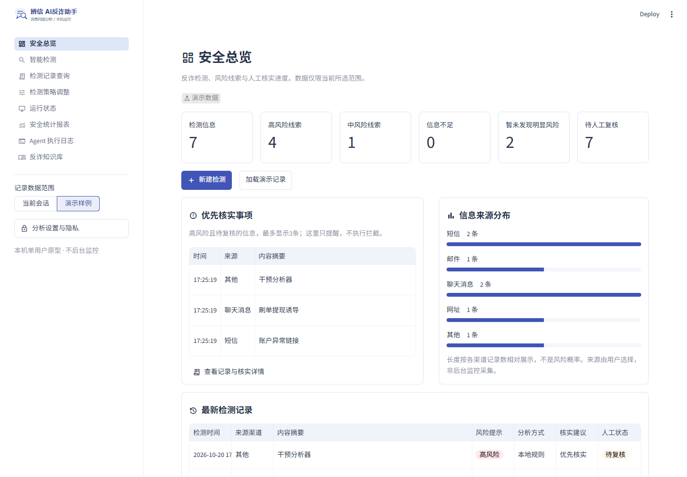
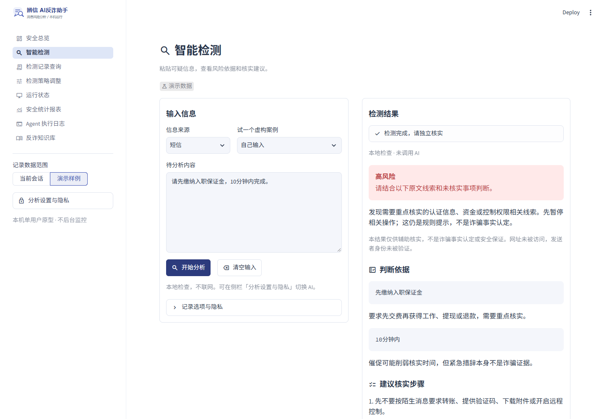
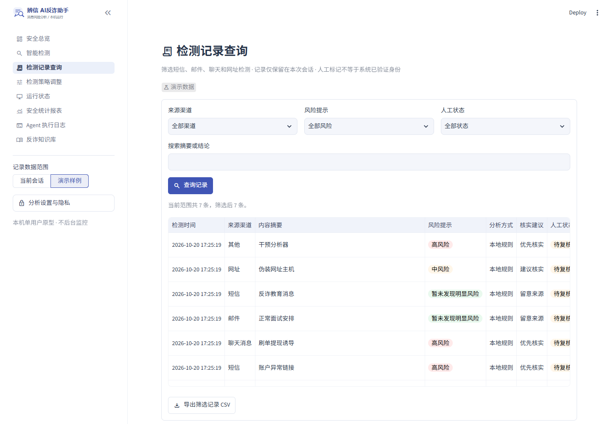
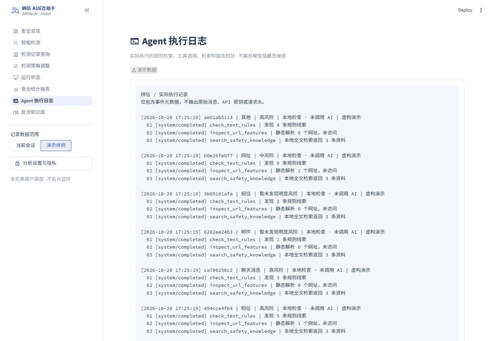

# 辨信 · AI 反诈与钓鱼信息检测助手

[](https://github.com/WHQ7/anti-fraud-agent/actions/workflows/tests.yml)

用于课程学习和本机个人使用的安全分析原型。粘贴短信、邮件、招聘聊天或网址，查看风险线索、原文依据、核实建议和参考资料。

技术栈：Python 3.12 · Streamlit · DeepSeek Tool Calling · HTTPX · 本地词法检索 · unittest / AppTest · GitHub Actions。

蓝白管理台包含左侧导航、六个统计卡片、优先核实事项、来源分布和最新记录。检测页采用输入与结果双栏，手机端上下排列。使用 Streamlit 原生主题，无外部字体请求或私有 CSS 覆盖。

## 界面预览

以下截图由当前版本实际运行生成，使用虚构案例和本地规则，不消耗模型额度。





<details>
<summary>查看更多：记录查询与工具执行日志</summary>





</details>

## 数据与分析方式

总览默认展示真实会话的零起点数据。点击“加载演示记录”会用7条虚构案例实际执行本地规则，不调用模型；演示与真实记录独立，页面明确标记。新检测可选择在本次会话内保留最近50份已脱敏报告，关闭开关则不加入列表。所有记录只存内存，不写入磁盘。

“优先核实 / 建议核实 / 补充信息”是提醒，不是消息拦截或身份认证。界面没有虚构风险分、终端列表、管理员推送或监控状态。

**不是诈骗事实认定工具，不提供网站安全认证，不保证无误报或漏报。不要把真实密码、验证码、密钥输入工具。**

## 快速开始

先安装 Python 3.12，再克隆项目：

```bash
git clone https://github.com/WHQ7/anti-fraud-agent.git
cd anti-fraud-agent
```

按照下一节创建虚拟环境并安装依赖后，Windows 用户可双击 `start.bat`，也可使用手动启动命令。

### Windows 启动脚本

双击项目中的 `start.bat`，然后在浏览器打开：

<http://127.0.0.1:8503>

启动脚本会优先使用项目自己的 `.venv`，没有时使用上一级目录已有的 `.venv`，不自动下载依赖或修改系统设置。运行时保持终端打开；在终端按 `Ctrl+C` 停止服务。若 8503 已被占用，可在下面的手动命令中改端口。

默认是**本地检查**：不联网，不调用模型，不消耗额度。

使用真实 Agent：

1. 在左侧“分析设置与隐私”中选择 `DeepSeek Agent`。
2. 确认显示“已读取 apikey”。支持已有进程环境变量 `apikey` 或 `DEEPSEEK_API_KEY`；Windows 下也会只读取用户已授权的注册表环境变量 `apikey`，处理应用尚未重启的情况。不会枚举、显示或保存其他环境变量。
3. 输入信息，检查“脱敏后的分析内容”。脱敏只是尽力处理，可能遗漏，请自行去除敏感信息。
4. 勾选同意发送到 DeepSeek，再点击“开始分析”。费用由你的 API 账户承担。

默认进入“安全总览”，点击“新建检测”或左侧“智能检测”，输入内容后点击“开始分析”。左侧菜单直接进入记录、策略、运行状态、统计、日志及知识库；“检测记录查询”支持筛选、人工标记和导出。提醒策略只修改本次会话内提醒和网址详情显示，不改变风险结论或下发系统策略。清空记录需要明确确认。侧栏可切换数据范围和分析方式；总览的“加载演示记录”显式生成虚构本地样例。

不需要把密钥填写进代码、`.env.example`、报告或 GitHub。程序不会自动加载 `.env`。

### 安装依赖与手动启动

建议 Python 3.12。在此项目文件夹打开 PowerShell：

```powershell
py -3 -m venv .venv
.\.venv\Scripts\python.exe -m pip install -r requirements.txt
.\.venv\Scripts\python.exe -m streamlit run streamlit_app.py --server.address 127.0.0.1 --server.port 8503
```

如果使用当前工作区的上一级虚拟环境：

```powershell
..\.venv\Scripts\python.exe -m streamlit run streamlit_app.py --server.address 127.0.0.1 --server.port 8503
```

macOS / Linux：

```bash
python3 -m venv .venv
.venv/bin/python -m pip install -r requirements.txt
# 在运行环境中设置 apikey，不要把真实值提交到仓库。
.venv/bin/python -m streamlit run streamlit_app.py --server.address 127.0.0.1 --server.port 8503
```

项目依赖按本机验证过的 Streamlit 1.66 系列限定。默认模型是 `deepseek-flash`，接口固定为官方 `https://api.deepseek.com/chat/completions`；模型名可通过 `DEEPSEEK_MODEL` 修改。模型可用性随服务商变化，以 [DeepSeek 官方文档](https://api-docs.deepseek.com/) 为准。

## 已实现功能

- 中文网页：输入、虚构案例、隐私预览、结果、资料和项目说明。
- 8页控制台、会话记录筛选、人工复核标记、统计报表、提醒策略及实际工具日志；演示数据独立。
- 两种模式明确区分：本地规则检查 / DeepSeek 工具调用 Agent。
- 尽力替换手机号、邮箱、部分认证信息、网址用户信息和敏感查询参数。
- 规则命中包含原文位置；否定句处理限制在分句，避免“无需笔试”抵消后续交费要求。
- 最多静态解析 8 个网址：实际主机名、用户信息、IP、端口、国际化域名等。
- 6 条带公开来源的本地知识摘要，采用中文双字切分、关键词与 BM25 风格排序。
- 三个只读工具，模型可自主选择；执行结果回传模型，最多两轮工具决策、6 次模型工具调用、3 次模型请求，无自动重试。
- JSON 报告结构校验、原文片段校验、资料编号校验；校验不代表语义判断必然正确。
- 模型与本地强规则冲突时，页面明确提示人工复核。
- 失败时明确标记“AI 未完成”，保留本地结果，不伪装为 AI 分析。
- 仅按用户点击下载 TXT / JSON 报告，服务器不主动保存原文或历史。

## Agent 和检索到底做了什么

```text
用户输入
  └─ 本地尽力脱敏与预览
       ├─ 本地模式：规则 + 静态网址 + 本地检索 → 明确标记的规则报告
       └─ 用户确认外部调用
            └─ DeepSeek 选择白名单工具
                 ├─ check_text_rules          当前文本规则线索
                 ├─ inspect_url_features      当前文本的网址字符串解析
                 └─ search_safety_knowledge   本地资料检索
                      └─ 回传工具结果 → 最终 JSON → 校验 → 页面 / 下载
```

模型不能给工具任意网址、文件路径、Shell 命令或环境变量名称。规则和网址工具只处理当前已脱敏文本。所有用户内容、引语、模型建议都不作为可执行指令。

如果模型未调用工具，由系统补充检索并如实标记 `actor=system`，不伪造模型工具调用。执行记录是实际事件，不是模型隐藏思维链。

当前是**本地词法检索增强生成**，不是 Embedding / 向量数据库 RAG，不应在简历中写成已实现向量检索。后续可以替换 `guard/knowledge.py` 的检索器，保持工具接口不变。

## 项目结构

```text
streamlit_app.py       页面与会话交互
app_pages/            总览、检测、记录、策略、状态、统计、日志和知识库页面
ui/common.py          共享页面组件、会话状态与记录注册
assets/               控制台样式与本地 SVG 标识，无外部字体请求
guard/
  config.py           读取指定环境变量，不回显密钥
  privacy.py          本地尽力脱敏
  rules.py            可解释风险线索与否定语境
  urls.py             无网络的网址字符串分析
  knowledge.py        本地词法检索
  transport.py        唯一外部网络边界，固定 DeepSeek HTTPS 接口
  agent.py            受控工具执行、预算、状态与失败处理
  reports.py          报告校验和文本导出
  console.py          会话记录、筛选、统计、策略和安全 CSV 导出
data/
  knowledge.json      公开来源的人工中文摘要
  examples.json       全部明确标记为虚构的网页案例
  evaluation.json     本地规则合成回归样例
tests/                单元、模拟接口与 Streamlit 无头交互测试
evaluate.py           本地规则回归，不调用模型
live_smoke.py         显式确认后才执行的真实 API 联调
docs/作业演示指南.md   实际运行截图建议与当前完成范围
```

## 测试与验证

在项目目录执行；如果用自己的虚拟环境，把 `..\.venv` 改成 `.\.venv`：

```powershell
..\.venv\Scripts\python.exe -X utf8 -m unittest discover -s tests -v
..\.venv\Scripts\python.exe -X utf8 evaluate.py
```

截至 2026-10-20 本机验证：

- 73 项自动化测试通过，包含核心逻辑、模拟模型工具调用、网络异常、8页交互、演示分离、策略应用、人工复核同步、确认清空记录、总览首页和默认展开的 AI 脱敏预览。
- 隔离浏览器验证通过：侧栏导航、桌面六卡同排、隐私设置、桌面检测及390px手机端检测；本次界面微调测试未调用付费模型。
- 32 / 32 条本地合成回归样例满足当前预期。样例由本项目编写，不是独立测试集，**不能当作真实诈骗识别准确率**，也不衡量 DeepSeek 效果。
- 一次真实 API 联调成功：仅发送内置虚构招聘样例，3 次模型请求、2 次模型请求执行工具，报告通过引用和原文校验。不是大规模模型评测。

可选真实联调（付费、联网，不在测试套件或 CI 中运行）：

```powershell
..\.venv\Scripts\python.exe -X utf8 live_smoke.py --confirm-api-cost
```

只发送内置虚构样例，不打印密钥、请求头或用户私人输入。不要循环执行以刷出好看的结果。

部分受限 Windows 沙箱不允许 Python 创建自己的回环 socket，`AppTest` 可能在初始化时卡住；在正常本机终端运行即可。它不需要打开网页服务或调用 API。

## 安全与隐私边界

- **不访问可疑链接**：无 DNS、网页抓取、重定向展开、证书查询、文件下载或实时黑名单接口。
- **不保证脱敏完整**：名字、地址、复杂标识、变形号码等可能漏检。真实分析前必须人工检查预览。网址用户信息会被替换，因此报告不保留其原貌。
- **不持久化用户输入**：只在当前会话内存中保留输入与结果，不承诺标签页关闭后立即擦除内存。不要在公用电脑中粘贴私密信息。
- **外部数据流向可见**：只有确认 Agent 模式后，分析内容和工具结果才会发送到 DeepSeek。API 凭据只出现在对固定官方接口的认证头，不进入模型消息。
- **不渲染不可信 HTML / Markdown**：用户、模型和可疑网址使用文本或代码组件展示，不生成可疑链接按钮。来源按钮来自内置知识库。
- **限本机单用户**：默认仅监听 `127.0.0.1`；无公网身份认证、速率限制或租户配额，不能直接暴露到公网。
- 提示注入防护依靠工具权限、参数限制、次数预算和输出校验，而不是宣称一条系统提示词能解决问题。
- 判定仍可能误报、漏报或产生不恰当建议，结构与引用有效不代表推理正确。

## 资料与下一步

资料正文是基于公开来源编写的简短中文学习摘要，不复制原文、图片或商标。来源和适用范围保存在 `data/knowledge.json`。FTC 资料来自美国，仅借鉴通用风险模式，不把其司法流程、举报方式当成中国本地指南。

后续可按需要补充：中国本地权威资料、独立标注测试集、Embedding 检索、截图 OCR、人工确认的历史管理、FastAPI / React 前后端分离。以上尚未实现，不能当作当前成果展示。

本项目在 AI 辅助下开发。仓库仅包含源代码、公开资料摘要、虚构样例、测试及展示截图。`.venv`、真实 API 密钥、个人检测报告和运行日志不纳入版本管理。学习和二次开发时，请阅读核心代码并理解工具循环。

可选浏览器检查：`tests/browser_check.cjs` 使用 Playwright 和本机 Edge，只创建独立测试会话，不调用真实模型。需要 Node.js、Playwright 和 Edge；不属于 Python 运行依赖，不自动安装。截图默认保存在系统临时目录的 `anti-fraud-refined-console-preview` 文件夹。该脚本会运行虚构样例并测试桌面/手机布局，不操作你已有的浏览器会话。
